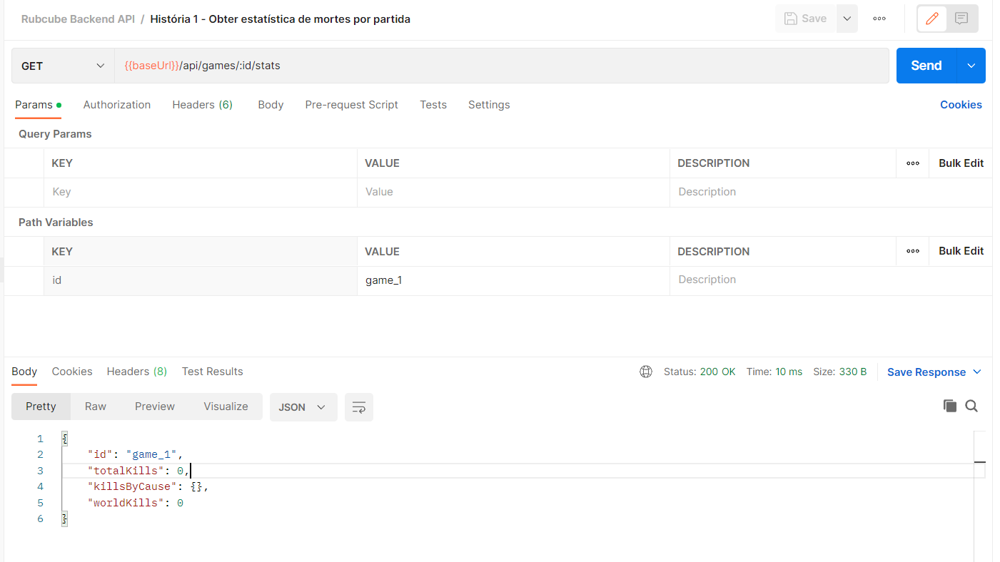
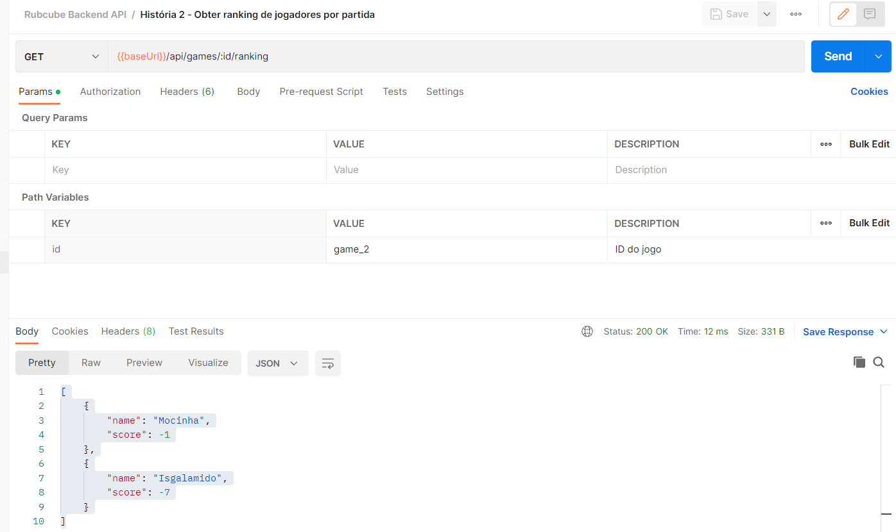
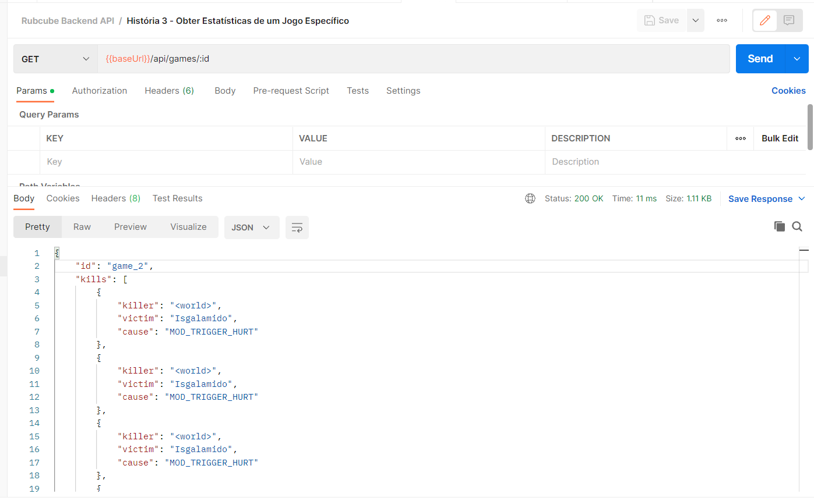
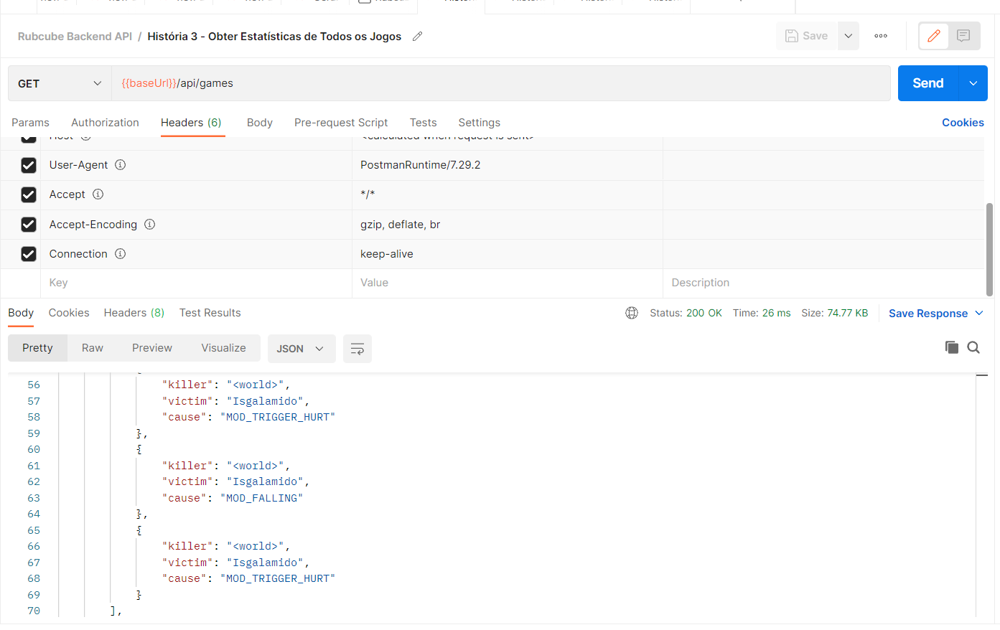

# Rubcube Backend API

Solução do exercício técnico "Quake log parser" (backend): uma API REST que lê
o log de partidas do Quake 3 e expõe estatísticas de mortes, ranking e dados
gerais de cada partida.

**Stack:** Node.js, TypeScript, Express 5, Helmet, Jest + Supertest, ESLint,
Prettier, Husky, lint-staged e commitlint (Conventional Commits). O código usa
uma camada de serviços (Service Layer Pattern).

---

## Executar

### Pré-requisitos

- [Node.js](https://nodejs.org/) 22 ou superior
- npm

### Passo a passo

```sh
git clone https://github.com/lucasrennok/RubcubeBackend.git
cd RubcubeBackend
npm install
cp .env.example .env   # Windows: copy .env.example .env
npm run dev
```

A API sobe em `http://localhost:3000`.

### Scripts

| Script                                    | O que faz                             |
| ----------------------------------------- | ------------------------------------- |
| `npm run dev`                             | Servidor com recarga automática (tsx) |
| `npm run build` / `npm start`             | Compila para `dist/` e executa        |
| `npm test` / `npm run test:coverage`      | Testes unitários e de integração      |
| `npm run lint` / `npm run typecheck`      | ESLint e checagem de tipos            |
| `npm run format` / `npm run format:check` | Prettier                              |

### Variáveis de ambiente

| Variável      | Padrão           | Descrição                                 |
| ------------- | ---------------- | ----------------------------------------- |
| `PORT`        | `3000`           | Porta HTTP                                |
| `HOST`        | `0.0.0.0`        | Interface de rede                         |
| `CORS_ORIGIN` | `*`              | Origens permitidas, separadas por vírgula |
| `LOG_PATH`    | `logs/games.log` | Caminho do log do Quake                   |

## Endpoints

| Método  | Rota                     | Descrição                                          |
| ------- | ------------------------ | -------------------------------------------------- |
| **GET** | `/api/games`             | Estatísticas gerais de todos os jogos (história 3) |
| **GET** | `/api/games/:id`         | Estatísticas gerais de um jogo (história 3)        |
| **GET** | `/api/games/:id/stats`   | Mortes detalhadas de um jogo (história 1)          |
| **GET** | `/api/games/:id/ranking` | Ranking de um jogo (história 2)                    |
| **GET** | `/health`                | Health check                                       |

Os IDs seguem o formato `game_1`, `game_2`... Um jogo inexistente retorna
`404 { "error": "Jogo não encontrado" }`.

### Regras do ranking

- Matar outro jogador: **+1** para quem matou e **-1** para quem morreu
- Morrer para o `<world>`: **-1**
- Suicídio: não altera a pontuação
- A pontuação é contada pelo ID do jogador, então quem troca de nome no meio
  da partida mantém os pontos e aparece com o último nome usado

### Postman

A collection `Rubcube Backend API.postman_collection.json` tem uma requisição
para cada história. Importe no Postman e defina a variável `baseUrl` como
`http://localhost:3000`.

## Resultados









## Melhorias posteriores à entrega

- Log lido de forma assíncrona e mantido em cache (antes, cada requisição
  relia o arquivo inteiro de forma síncrona)
- Ranking contado pelo ID do jogador, corrigindo a pontuação de quem troca de nome
- Linhas de chat que contêm "Kill:" não são mais contadas como mortes
- `404` para jogos inexistentes em todas as rotas (antes algumas retornavam `200` com `null` ou `[]`)
- Express 5, Helmet, CORS configurável, tratamento central de erros e encerramento gracioso
- Testes de integração com Supertest sobre o log real e testes do parser (~97% de cobertura)
- Dependências atualizadas (TypeScript 6, Jest 30, ESLint 9, commitlint 21) e CI checando formatação, tipos e vulnerabilidades

## Dificuldades

- Entendimento do arquivo de log
- Necessidade de banco de dados ou não
- Configuração inicial do ambiente foi demorada
- Entendimento do que deveria ser retornado na História 3
- Tempo
- Frustrante na execução dos testes por familiaridade

## Sobre o processo

Foi interessante, acabei colocando em prática algumas tecnologias e organização inicial de código que eu havia esquecido e acabei relembrando. Foi complicado o entendimento do log e como eu iria filtrar as informações, pensei em colocar em um banco de dados mas eu não teria tempo para isso então preferi deixar só o log mesmo por enquanto.

Aprendi mais sobre criação de testes e isso foi uma parte um pouco demorada, eu desejava ter feito um coverage de 100% do código mas não daria tempo, então deixei apenas das funções que consegui realizar no tempo.

Tentei organizar da melhor forma o código e parte dele em pastas para esse projeto. Acredito que tenha sido o melhor para o backend.
